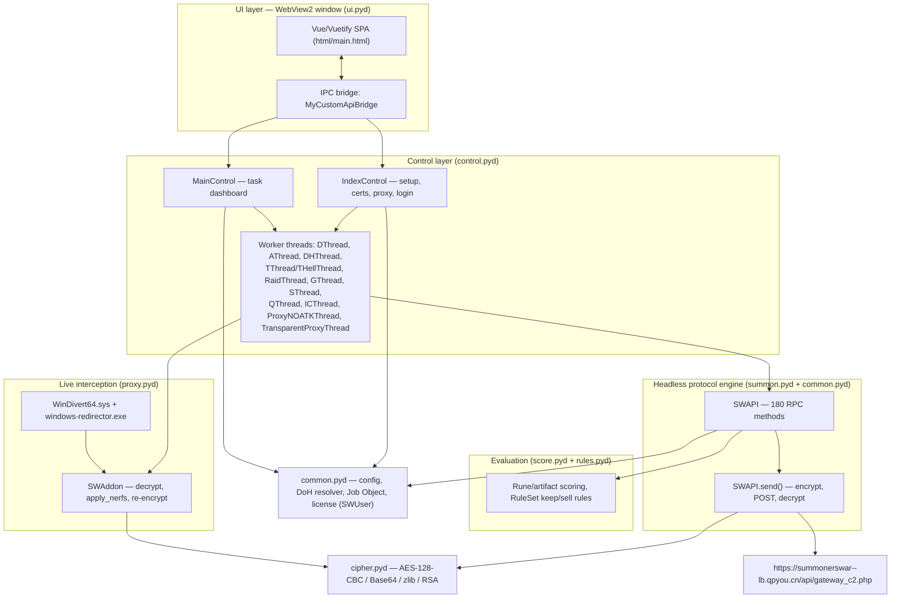

# AutoSW — Architecture Breakdown (Developer Reference)

> Part of the `autosw-revival/docs/` revival set. This is a **neutral,
> code-oriented** description of what the application is and how its parts fit
> together, written for reviving / rebuilding it. Security findings live in
> [`../../work/autosw/report/AUTOSW_DETAILED_ANALYSIS.md`](../../work/autosw/report/AUTOSW_DETAILED_ANALYSIS.md)
> (§9–10); the wire format lives in `02-crypto-protocol.md`.

## What AutoSW is

AutoSW is a **Windows desktop automation suite for Summoners War: Sky Arena**,
built as a frozen PyInstaller executable (Python 3.11 + Cython `.pyd` native
modules) with an Edge WebView2 HTML frontend. It has two fundamentally
different operating modes:

| Mode | Engine | How it works |
|------|--------|--------------|
| **Headless bot** | `summon.pyd` → `SWAPI` | Speaks the game's native encrypted HTTP protocol (`gateway_c2.php`) directly. No game client or emulator is needed — it starts battles, sleeps a simulated clear-time, submits results, evaluates drops, sells junk, refills energy. |
| **Live proxy ("NO-ATK")** | `proxy.pyd` → `SWAddon` + WinDivert / mitmproxy | Sits between a real game client (PC client or Android emulator) and the game server, decrypts battle-start responses in flight, rewrites enemy monster stats (the "nerf" algorithm), re-encrypts, and forwards to the client. |

## High-level data flow

## Module map

| Module | Type | What it does | Key classes / entry points |
|--------|------|--------------|---------------------------|
| `main.exe` | PE32+ PyInstaller bootloader | Unpacks Python 3.11 runtime, launches `ui.main()` | — |
| `ui.pyd` | Cython | WebView2 window bootstrap, tray icon (`pystray`), binds the JS↔Python bridge | `main()`, `MyCustomApiBridge` |
| `control.pyd` | Cython | Setup wizard + task scheduler + all worker threads; cert injection (`certutil`); ADB/emulator control | `IndexControl`, `MainControl`, `DThread`… (see `03-module-reference.md`) |
| `summon.pyd` | Cython | The headless game client: all 180 `SWAPI` RPCs, dungeon/arena/ToA/raid/guild loops, drop handling | `SWAPI` (see `04-swapi-reference.md`) |
| `common.pyd` | Cython | Shared plumbing: global config, DoH resolver, Windows Job Object, license/user model; re-exports `SWAPI` from `summon` (not a base class) | `SWUser`, `query_doh`, `assign_process_to_job_object`, `SWAPI` (re-export) |
| `cipher.pyd` | Cython | Crypto primitives used by both modes | `encrypt`/`decrypt`, RSA token routines (see `02-crypto-protocol.md`) |
| `proxy.pyd` | Cython | mitmproxy addon that tampers live battle responses | `SWAddon`, `apply_nerfs`, `nerf_unit` |
| `score.pyd` | Cython | Rune/artifact math: weights, efficiency, roll potential | `calc_artifact_score`, `calc_skill_completion`, `collect_battle_rune_set_context` |
| `rules.pyd` | Cython | Rule engine over `rules.json` (user-defined keep/sell criteria) | `RuleSet` |
| `windows-redirector.exe` | Go binary | Bridges WinDivert kernel capture → local mitmproxy port (transparent redirect) | CLI (`--mode local:SummonersWar.exe`) |
| `WinDivert64.sys` | Kernel driver | Captures outbound TCP/443 from the game process | — |
| `update.exe` + `7za.exe` | Native utilities | Auto-update: download zip → unpack → restart `main.exe` | — |

## The two runtime flows in detail

### Headless bot flow (per dungeon run)

1. `MainControl.dungeon` → spawns `DThread` with user config (dungeon id, stage, repeats, refill policy).
2. `DThread` calls `SWAPI.DoDungeon` → `SWAPI.send("BattleDungeonStart", ...)`.
3. The **response already contains the drop table** — AutoSW reads it immediately, before "fighting".
4. It computes a realistic clear time (`getTowerTime` / configured delay), sleeps that long.
5. `SWAPI.send("BattleDungeonResult", ...)` submits the win.
6. Drops go through `eval_rune` / `handle_artifact` → `rules.pyd` → `sellRune` / `SellArtifacts` if below thresholds.
7. Energy low → `smart_refill` buys refills with crystals/social points; rune inventory near cap → `inventory_clean`.

### Live proxy ("NO-ATK") flow

1. `MainControl.noatk_proxy` → `ProxyNOATKThread` (manual proxy) or `TransparentProxyThread` (WinDivert).
2. WinDivert captures the game process's outbound TLS; `windows-redirector.exe` feeds it to the local mitmproxy on `127.0.0.1:8080`.
3. `SWAddon` (a mitmproxy addon) decrypts responses matching the nine battle-start commands (see `03-module-reference.md` §SWAddon), rewrites enemy units via `apply_nerfs`, re-encrypts, and forwards.
4. Trust is established because the app installed its `swfarm CA` root into the Windows store (PC client) or the emulator cert store via ADB `tmpfs` mount (Android).

## Process / threading model

One OS process (`main.exe`) hosting:

- WebView2 UI (separate renderer process, IPC via bridge).
- Main Python thread: UI event loop, tray, log buffer.
- One `threading.Thread` subclass **per enabled task** (`DThread`, `AThread`, `DHThread`, `TThread`, `THellThread`, `RaidThread`, `RThread`, `GThread`, `SThread`, `QThread`, `CollabQuestsThread`, `ICThread`). Tasks declare conflicts via `task_conflict` so two energy-consuming tasks don't run simultaneously.
- Proxy threads only while NO-ATK mode is active.

Everything shares one `SWAPI` session; config/rules are read from JSON files next to the executable (`rules.json`, account profiles, license state via `SWUser`).

## External touchpoints

| Touchpoint | Purpose |
|------------|---------|
| `summonerswar-{sea,eu,us}-lb.qpyou.cn` | Game gateway (region per `server_id`) |
| `223.5.5.5/dns-query` | Alibaba DoH resolver to pin game-host IPs |
| `autosw.net` | License check (`IndexControl.login`), updates (`check_update`) |
| `coupon.qpyou.cn` / `swq.jp` | Promo-code fetching & redemption |
| ADB (5037) | Emulator cert push, proxy set, root checks |
| Steam / Google Play Games PC client | Intercepted via WinDivert path |
