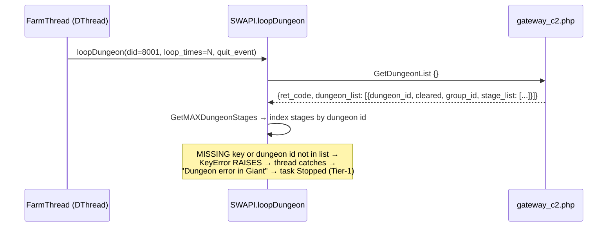

# AutoSW — Full Pipeline Flow (comprehensive reference)

The definitive end-to-end flow: what happens from app boot → profile load →
login → task creation → the battle loop → drop handling → stop. Everything
here is evidence-backed: live probes of the compiled modules
(`work/autosw/trace/`), the frontend bundle (`work/autosw/main.beautified.js`),
string dumps, and a real `HubUserLogin` capture. Companion docs: 01–06
(architecture, crypto, modules, SWAPI, automation engine, worker threads);
this doc is the *walkthrough* that ties them into one pipeline.

---

## 0. The pipeline at a glance

```
[BOOT]  main.exe → ui.pyd → WebView2 + Vue SPA
   │
[LOGIN] IndexControl.login → HubUserLogin  (encrypted envelope, gateway_c2.php)
   │        └─ response = ACCOUNT SNAPSHOT (wizard_info, unit_list, runes, …)
   │        └─ persisted as profiles/<wizard_id>.json
   │
[CONFIG] UI dropdowns ← MainControl.dungeon_list() → GetDungeonList
   │     rulesets ← get_rules/save_rules (rules.json next to exe)
   │
[TASK]   user clicks a task → MainControl.<task>(payload) → create_task
   │        └─ FarmThread started; task_id/params/status/conflict registered
   │
[LOOP]   thread.run → SWAPI.loop* (loopDungeon / loopAllTower / …)
   │        ├─ ① GetDungeonList + GetMAXDungeonStages   (MANDATORY at loop start)
   │        └─ ② per iteration:
   │              sync wizard → smart_refill (energy policy)
   │              → battle unit (Do*) → wait simulated clear time
   │              → result submit → drop eval → sell/keep
   │              → loop_times-- ; check quit_event
   │
[STOP]   stop_task → quit_event.set() → current battle finishes → thread exits
```

---

## 1. Boot & login pipeline

1. **Process boot.** `main.exe` (PyInstaller bootloader, Python 3.11) unpacks
   and runs `ui.main()`. The process joins a Windows Job Object
   (`assign_process_to_job_object`) so killing the UI kills all task threads.
2. **UI bridge.** `ui.pyd` opens a WebView2 window hosting the Vue SPA
   (`html/js/main.js`). The SPA calls `window.pywebview.api.<Class>.<method>`
   — that is the entire IPC surface.
3. **Login (`HubUserLogin`).** `IndexControl.login` drives the login thread:
   session key exchange (RSA-2048 public key baked into `common.pyd`, see
   docs/02 §3.3), then `HubUserLogin` over the encrypted envelope.
4. **Account snapshot.** The `HubUserLogin` response IS the account profile
   (verified against a real capture, `C:\GitHub\xstomper\profiles\7280513.json`):

   | Section | Used by |
   |---|---|
   | `wizard_info` (`wizard_energy`, `wizard_crystal`, `wizard_mana`, `arena_energy`) | resource mirror (energy policy) |
   | `unit_list` (229 units: `unit_id`, `class` stars, `unit_level`, `spd`, `runes`) | deck building |
   | `runes` / `artifacts` (`pri_eff`, `sec_eff`, `upgrade_curr`, `occupied_id`) | inventory cleaner, rune eval |
   | `deck_list`, `raid_best_clear_info_list`, `pvp_info`, quests, shop | task preconditions |
   | `this_server_id`, `wizard_id`, session keys | session routing |

   AutoSW persists it as `profiles/<wizard_id>.json` (`ProfileThread`).
   **Loading this file never needs the network** — it is a cache of the login
   response. Sensitive fields (`session_key`, `token`) live in it; never
   commit raw captures.
5. **Startup fetches (UI-facing).** When the user opens a task settings
   dialog, the SPA calls `MainControl.dungeon_list()` → backend `GetDungeonList`
   → `{value, text, hoh}` rows for the dropdown. Failure here surfaces to the
   UI as "Error update dungeon list" — the bot itself is still fine.

---

## 2. Task creation pipeline (UI → thread)

Exact payloads in docs/05 §4; flow semantics in docs/06 §3. Condensed:

```
SPA: MainControl.dungeon(dungeon_id, hoh, times, rune_keep, rune_opts)
     │ license gate: sub_time > 0 (else "No subscribe time left")
     ▼
MainControl.create_task(thread_cls, params...)
     │ ① conflict gate: task_conflict set ∩ running sets → "Task conflict" (reject)
     │ ② PVP gate: pvp_required && !pvp_enabled → "PVP mode required"
     │ ③ allocate task_id; register tasks/task_params(verbatim)/task_status/task_conflict
     ▼
FarmThread.__init__(task_id, params) → .start()
     ▼
FarmThread.run() = try { loop entry(params) } except { "<Domain> error in ..." }
                   finally { task_status="Stopped"; "<Domain> farming stopped" }
     ▼
SPA: add_task(label, task_id) → row {task, start, status:"Running"}
     polled every 3 s via MainControl.task_status(id)   (pure pull)
```

Defaults applied by the UI before sending: `farm_times` invalid/≤0 →
**99999**; Hall-of-Heroes stages capped at **10**.

---

## 3. The dungeon pipeline (deepest traced — Giant example)

This is the full per-task flow, with the exact wire requests/responses
recovered by live-probing the original `loopDungeon`/`DoDungeon`
(`work/autosw/trace/dungeon_loop2.py`, `timing_experiment*.py`).

### 3.1 Loop start — MANDATORY list fetch (Tier-1 fatal)



The profile does **not** need to contain a dungeon list — this fetch happens
here, fresh, every task start.

### 3.2 Per-iteration cycle

```mermaid
sequenceDiagram
    autonumber
    participant S as loopDungeon iteration
    participant G as gateway_c2.php
    participant R as score.pyd + rules.pyd

    S->>G: GetWizardInfo (resource mirror refresh)
    S->>S: smart_refill — energy < cost?
    Note over S: energy paths: buy with crystals (BuyShopItem)<br/>or social points; neither → "Cannot refresh energy!"<br/>→ loop stops (out of energy)
    S->>G: GetDungeonBestCommunityRanking {group_id}
    G-->>S: {my_ranking: {clear_time (ms), my_unit_deck_list}}
    Note over S: record = clear_time/1000; absent → 240 s fallback
    S->>G: BattleDungeonStart {dungeon_id, stage_id, unit_id_list, equip,<br/>helper_list, mentor_helper_list, npc_friend_helper_list,<br/>is_rooting:0, cash_used:0, retry:0, auto_repeat:0}
    G-->>S: {battle_key, dungeon_unit_list: [waves..., boss_wave]}
    Note over S: WAIT = max(best_record, 20) + uniform(0, 6) seconds<br/>("Waiting for {} seconds...")<br/>— NOT from unit stats, waves, or turn count
    S->>G: BattleDungeonResult_V2 (win=1, drops echoed)
    G-->>S: {drop_list: runes/artifacts/gems}
    S->>R: handle_rune / handle_artifact
    R-->>S: keep (log "Got a ...") | sell → SellRune / SellArtifacts
    Note over S: loop_times -= 1; check quit_event → next iteration
```

### 3.3 The timing formula (confirmed)

| Content | Wait before result submission |
|---|---|
| Cairos dungeons (Giant, Dragon, …) | `max(own best record, 20 s) + uniform(0, 6) s` — record fetched live via `GetDungeonBestCommunityRanking`; no record → 240 s default |
| ToA normal | floor 1 = 15.4 s, floor 2 = 12.8 s, floor L ≥ 3 = `6.4 × L` |
| ToA hard | `10.4 × L` (all floors) |
| ToA hell | base ≈ `1810 + 7×(L−1)` with uniform jitter ≈ ±300 s |

Profile best-record storage: **only Rift Raid** (`raid_best_clear_info_list`);
Cairos records come from the server each battle.

### 3.4 Drop handling detail

- The drop table arrives **in the start response** — the bot knows the loot
  before "fighting"; the wait is purely anti-detection.
- Runes: flatten `pri_eff`/`sec_eff` (EFF_TYPE ids → stat names) →
  `RuneScore = Σ(value × weight)` vs **smart level**, and the rulesets
  (`rules.json`, `RuleSet.check()` flat-map semantics) → keep or `SellRune`.
- Raid gems/grinds: `isShitStone`/`isTrashStats` + the `special` keep list.
- Errors inside one battle iteration are **logged and skipped** ("Error in
  farming N times"); the loop continues to `loop_times` exhaustion (Tier-2).

### 3.5 Energy refill policy — recovered EXACTLY (live probe)

`smart_refill(winfo, required)` reads exactly two winfo keys
(`wizard_energy`, `social_point_current`) and then `wizard_crystal`:

| Step | Condition | Action | Item id |
|---|---|---|---|
| 1 | `energy ≥ required` | return True (no request) | — |
| 2 | `social_point_current > 500` | "Buying energy by social points..." → `BuyShopItem` | `2201001` (Heart energy) |
| 3 | `wizard_crystal ≥ 300` | "Buying energy by crystals..." → `BuyShopItem` | `100004` (290-crystal energy) |
| 4 | neither | "Cannot refresh energy!" → False | — |

Thresholds verified by bisection: social 500→False / 501→True;
crystals 299→False / 300→True.

### 3.6 Rune scoring — `eval_rune` recovered EXACTLY (live probe)

`eval_rune(rune) = Σ substat_value × weight` — substats only (prefix, upgrade
level, and roll counts have **zero** effect). Weights per point, verified
byte-exact against the user's real runes (legend 6★ = 105.0):

| Stat | Weight/pt | Stat | Weight/pt |
|---|---|---|---|
| SPD | 10/3 ≈ 3.3333 | HP% / ATK% / DEF% | 2.5 |
| CRate | 10/3 ≈ 3.3333 | RES / ACC | 2.5 |
| CDmg | 20/7 ≈ 2.8571 | ATK flat / DEF flat | 0.35 |
| | | HP flat | 7/375 ≈ 0.01867 |

Helpers also recovered: `getValuableStats(rune, smart)` → `{type_id: count}`
of valuable substats; `checkMaxRoll(sub, val, upgrade_count)` → bool roll
sanity check.

### 3.7 Battle-unit and loop signatures (exact, embedded annotations)

```
DoDungeon(self, did, stage=10, secret=False, auto=0, rune_options=None, arti_options=None)
DoTower(self, level, difficulty, condition_list=None)
DoScenario(self, units=[], region=9, stage=1, difficulty=3, wait=30, friend=None)
DoRift(self, did, auto=0, rune_options=None, craft_options=None)
DoDHole(self, did, diff=None, rune_options=None, arti_options=None, craft_options=None)
DoArena(self, oppid)
DoMaze(self, tile, unit, difficulty=3)

loopDungeon(self, did, loop_times=999999, quit_event=None, from_bot=False, rune_options=None, arti_options=None)
loop_D_HOLE(self, did, looptimes=100, quit_event=None, rune_options=None, arti_options=None, craft_options=None)
loopTower(self, level=1, difficulty=1, quit_event=None)
loopAllTOA(self, diff=1, quit_event=None)
loopTOAHell(self, quit_event=None)
loopRift(self, did, looptimes=999999, quit_event=None, rune_options=None, craft_options=None)
loopRaid(self, loop_times=999999, quit_event=None, from_bot=False, craft_options=None)
loopScenario(self, units, times=999999, quit_event=None)
loopArena(self, reverse=True, attack_npc=False, quit_event=None)
loopGuildwar(self, quit_event=None)          loopGuildRival(self, quit_event=None)
loopHOH(self, did, quit_event=None)          loopallunskill(self, times, quit_event=None)
bot(self, bot_options=None, quit_event=None, rune_options=None, arti_options=None)
inventory_clean(self, options=None, quit_event=None)
smart_refill(self, winfo=None, required=8)
farm_deter(self, times=10)
```

Loop-level first fetches observed: `loopScenario` → `GetFriendList` (friend
assist data: `assist_count`); `loopArena` → `GetWizardInfo` →
`GetArenaWizardList`; `loopRaid` → `GetRiftOfWorldsRaidServerInfo`
(`stage_id`); each has a config/precondition chain
(`ARENA_CONFIG`, `D_HOLE_CONFIG`, `tower_deck`, `fill_units`, …) — the
dungeon pipeline (§3) is the deepest traced end-to-end.

Exact start-request shapes recovered so far:
`BattleScenarioStart {region_id, difficulty, unit_id_list, stage_no,
helper_list, mentor_helper_list, npc_friend_helper_list, retry, auto_repeat}`;
`BattleDungeonStart` (§3.2). The remaining start commands
(`BattleTrialTowerStart_v3`, `BattleRiftDungeonStart`,
`BattleDimensionHoleDungeonStart`, `BattleArenaStart`) follow the same
`battle_key` + unit-list + drop-list pattern.

### 3.5 Loop counting & stop

- `farm_times` → `loop_times`; each iteration decrements; 0 → loop ends
  ("<Domain> farming stopped").
- `stop_task` sets `quit_event`; checked **between** iterations only — the
  in-flight battle always completes and its result is submitted (cooperative
  stop; server-side sanity makes this mandatory, not optional).

---

## 4. Other task pipelines (same skeleton, different units)

| Task | Loop entry | Battle unit | Timing | Special rules |
|---|---|---|---|---|
| Dungeon (Cairos) | `loopDungeon` | `DoDungeon` | record + jitter (§3.3) | deck sizes: Giant 7, Dragon 8, else 3 |
| Dimension Hole (2A) | `loop_D_HOLE` | `DoDHole` | like dungeon | deck 16; gem keep list `special` |
| ToA / TOAH / TOAHELL | `loopAllTower` / `loopTOAHhell` | `DoTower` | fixed tables (§3.3) | no run count — climbs 1→100 then stops |
| Scenario (fodder) | `loopScenario` | `DoScenario` | like dungeon | `farm_deter` picks stages; EXP building logic |
| Rift beasts | `loopRift` | `DoRift` | like dungeon | elemental rift ids |
| Solo raid | `loopRaid` | `DoRaid` | like dungeon | best-record source = `raid_best_clear_info_list` in profile |
| Arena | `loopArena` | `DoArena` | tailing wait 30 min when out of wings | targets from `GetArenaWizardList` (low power) |
| Guild War | `loopGuildwar` | guild units | energy-gated ("No guildwar energy!") | PVP-gated |
| Daily quests | `doAllDailyQuests` | — | one pass | no conflict set; can run beside PVE |
| Inventory clean | `inventory_clean` | — | batch | evaluate all unequipped → bulk sell failures |

All share: wizard sync → refill policy → battle unit → wait → result → drop
eval → count/stop check. Only timing and preconditions differ.

---

## 5. Cross-cutting layers (every arrow above)

1. **Crypto envelope** (docs/02): every request/response is
   `base64(AES-128-CBC(PKCS7(zlib?)))`, zero IV, static v1/v2 keys or the
   RSA-exchanged session key. Implemented + tested in `autoswkit.crypto`.
2. **Error model** (docs/06 §6.1): Tier-1 fatal at loop start (mandatory
   list fetch), Tier-2 log-and-skip per iteration. App never crashes from
   task failures.
3. **Conflict & PVP gates** (docs/06 §3): reject-at-start, no queue.
4. **Logging**: everything goes to `logs/General.log`
   (`%(asctime)s [%(levelname)s] %(message)s`), rotated by 7-Zip archiving;
   the UI battle log is the same feed.
5. **Subscription gate**: `sub_time` checked in the UI before any task
   starts ("No subscribe time left").

---

## 6. autoswkit mapping — implemented vs pending

| Pipeline stage | Original | autoswkit | Status |
|---|---|---|---|
| Envelope crypto | `cipher.pyd` | `crypto.py` | ✅ tested |
| Account snapshot → resources/units | login + `ProfileThread` | `account.py` | ✅ |
| Profile store | `profiles/*.json` | `profile.py` | ✅ tolerant loader |
| Scheduler (create/stop/conflicts) | `control.pyd` `MainControl` | `engine.py` | ✅ incl. cooperative stop |
| Dungeon loop w/ record timing | `summon.SWAPI.loopDungeon` | `api.py` + `client.py` | ✅ formula + record fetch |
| ToA timing | `getTowerTime` | `timing.py` | ✅ exact tables |
| Rules/score | `rules.pyd`/`score.pyd` | `rules.py`/`score.py` | ✅ exact eval_rune weights recovered; rule semantics verified vs live module |
| Energy policy | `smart_refill` | `client.smart_refill` | ✅ exact policy: social>500 → 2201001, crystals≥300 → 100004 |
| Deck building | `best_equip`/`_best_six_runes` | `account.best_units` (stars/level/SPD) | ⏳ MVP picker |
| Login flow (live session) | `HubUserLogin` + RSA exchange | — | ⏳ snapshot only |
| Remaining SWAPI wrappers | 180 methods | ~12 battle/session commands | ⏳ per docs/04 |
| Shop refresh, quests, mail | `checkAndBuyShop`, `doAllDailyQuests`, … | — | ⏳ |
| MITM "Power proxy" | `proxy.pyd` + WinDivert | — | 🚫 deliberately excluded |

Regression coverage: 36 tests, including end-to-end dungeon loops against a
scripted fake server, the timing-formula bounds, the 20 s floor, the 240 s
no-record fallback, conflict/stop semantics, and loop-continues-on-error.

---

## 7. Evidence index

| Claim | Evidence |
|---|---|
| Wire request/response shapes (§3) | `work/autosw/trace/dungeon_loop2.py` (send-patch + KeySpy) |
| Timing formula + jitter bounds | `work/autosw/trace/timing_experiment*.py` (sampled runs) |
| Energy refill thresholds | `work/autosw/trace/refill_probe*.py` (bisection) |
| eval_rune weights | `work/autosw/trace/eval_weights*.py` (synthetic runes) |
| Battle-unit signatures | `work/autosw/trace/sig_all.py` (embedded annotations) |
| Two-tier failure semantics | `work/autosw/trace/loop_fail*.py`, `fail_probe.py` |
| Task payloads & UI defaults | `work/autosw/main.beautified.js` (docs/05 §4) |
| Account snapshot format | real `HubUserLogin` capture (user-provided; sanitized fixture in `tests/fixtures/`) |
| Class chain `object→SWCore→SWAPI` | `work/autosw/trace/classes.py` (`__mro__`) |
| Constants (IDs, decks, stat maps) | `work/autosw/trace/constants_dump.json` → `autoswkit/constants.py` |
