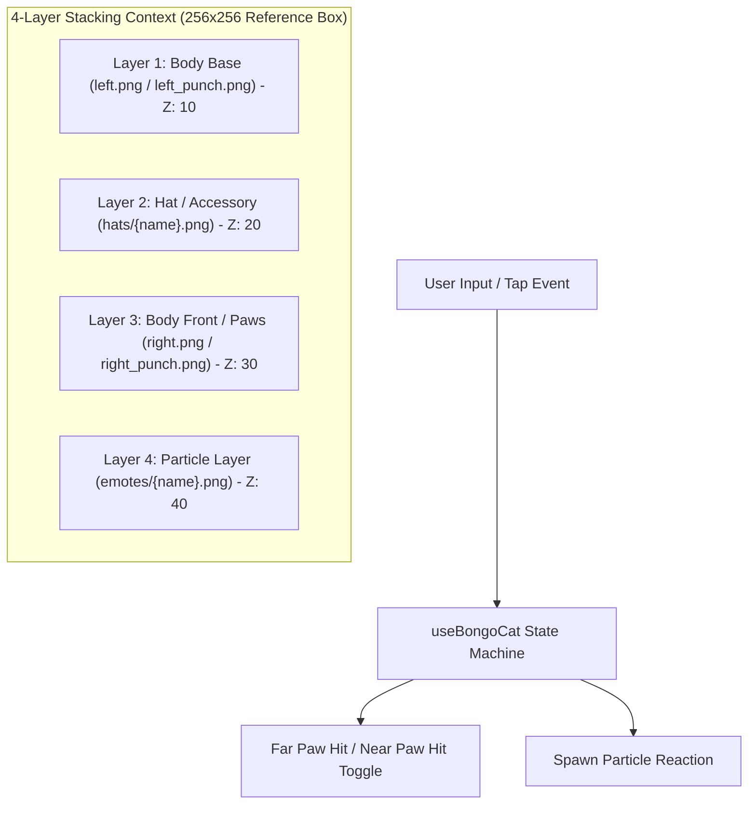

# 01 — Bongo Cat Architecture & Core Concepts

## 1. Overview & Core Metaphor

The **Bongo Cat Sprite Engine** is a high-performance, lightweight web rendering architecture that reconstructs the iconic Bongo Cat tapping and dressing mechanics. Instead of rendering monolithic animated GIF/Video assets or heavy Canvas/WebGL scenes, it uses a **4-Layer CSS Matrix Compositing System** backed by static cropped PNG frames.

---

## 2. The 4-Layer Stacking Engine

Each cat is constructed within a responsive bounding box with 4 depth layers:

| Layer | Component | File Path | Z-Index | Description |
| :--- | :--- | :--- | :--- | :--- |
| **Layer 1** | **Body Base** | `/skins/{skin}/left.png` `/skins/{skin}/left_punch.png` | `10` | The background body, left ear, and left paw rest/punch position. |
| **Layer 2** | **Accessory/Hat** | `/hats/{hat}.png` | `20` | Headwear, masks, glasses, or costumes positioned between body and front paw. |
| **Layer 3** | **Body Front** | `/skins/{skin}/right.png` `/skins/{skin}/right_punch.png` | `30` | The foreground face outline, desk surface, and right paw punch. |
| **Layer 4** | **Particles** | `/emotes/{emote}.png` | `40` | Floating hearts, sparkles, emojis, and reaction bubbles spawned on tap. |

### Why This Layering Matters
In standard sprites, equipping a hat either covers the paws or requires thousands of pre-baked sprite combinations ($213 \text{ skins} \times 372 \text{ hats} = 79,236 \text{ files}$). 
With this 4-layer composition:
- **Zero combination explosion**: 213 skins ($4 \text{ frames each} = 852 \text{ PNGs}$) + 372 hats ($1 \text{ PNG each}$) allows over **79,200 unique outfit permutations** in real-time with negligible memory footprint.
- **Natural Depth**: The right paw strikes *in front* of the hat/accessory, while the hat rests *in front* of the cat's forehead and behind the front paw.

---

## 3. Coordinate Normalization Math (`computeFrameStyle`)

Each extracted sprite has a Unity TextureRect coordinate `[x, y, w, h]` relative to a `256 x 256` bounding canvas.

### The Problem
- Unity uses a **Cartesian coordinate system (Y-Up)**: `(0, 0)` is bottom-left.
- Browsers use **Screen coordinates (Y-Down)**: `(0, 0)` is top-left.

### The Mathematical Transformation
To place any frame accurately regardless of scale:

$$\text{cx} = x + \frac{w}{2}, \quad \text{cy} = y + \frac{h}{2}$$

$$\text{dx} = \text{cx} - 128, \quad \text{dy} = \text{cy} - 128$$

$$\text{width} = \frac{w}{256} \times 100\%$$

$$\text{height} = \frac{h}{256} \times 100\%$$

$$\text{left} = \left(50 + \frac{\text{dx}}{256} \times 100\right)\%$$

$$\text{top} = \left(50 - \frac{\text{dy}}{256} \times 100\right)\%$$

$$\text{transform} = \text{translate}(-50\%, -50\%)$$

This guarantees pixel-perfect registration between all 4 layers at any container size (`48px` thumbnail up to `512px` hero widget).

---

## 4. Animation Timing & State Transitions

1. **Alternating Bongo Drum Hits (`Cat.Tap` logic)**:
   - On tap #1: `wasLeft = false` $\to$ Left paw hits (`left_punch.png`), hold for `160ms`, then returns to idle (`left.png`).
   - On tap #2: `wasLeft = true` $\to$ Right paw hits (`right_punch.png`), hold for `160ms`, then returns to idle (`right.png`).
2. **Idle Bobbing (`CatBobbing`)**:
   - Continuous subtle $Y$-axis scale oscillation: `scaleY(1)` $\to$ `scaleY(0.94) translateY(2.5%)` over a 1.6s ease-in-out cycle.
3. **Pat Squish Reaction (`CatPatter`)**:
   - When tapped or petted, the cat undergoes a brief squash and rebound curve:
     $$t_0: (1, 1) \longrightarrow t_{25\%}: (1.12, 0.84) \longrightarrow t_{60\%}: (0.92, 1.14) \longrightarrow t_{100\%}: (1, 1)$$
