# 07 — Tamagotchi Growth Chart & Attendance Coin Economy

This document specifies the **Tamagotchi-style Organic Evolution Engine** and the **Attendance Coin Wardrobe Economy** for the Bongo Cat streak pet.

---

## 1. The Dual-Track Philosophy

To create authentic personal attachment while preserving engaging gamification, the system operates on **two strictly separated tracks**:

```mermaid
flowchart TD
    %% EMPLOYEE ACTIONS
    subgraph DailyLoop ["Daily Attendance & Care Loop"]
        ClockIn["⏰ Clock In On-Time<br><i>(+25 Coins 🪙 | +50 EXP)</i>"]
        DailyTap["🐾 Tap & Play with Cat<br><i>(+5 Coins 🪙 | +10 EXP)</i>"]
        StreakBonus["🔥 Weekly Streak Milestone<br><i>(+100 Coins 🪙)</i>"]
    end

    %% TRACK 1: COIN SHOP WARDROBE
    subgraph Track1 ["🛍️ Track 1: Coin Wardrobe Shop (Player Choice)"]
        CoinBank[("🪙 Employee Coin Balance")]
        ShopHats["🎩 Buy Hats & Costumes<br><i>(374 Hats in Shop)</i>"]
        ShopEmotes["✨ Buy Reaction Emotes<br><i>(105 Emotes in Shop)</i>"]
    end

    %% TRACK 2: ORGANIC TAMAGOTCHI EVOLUTION
    subgraph Track2 ["🧬 Track 2: Organic Tamagotchi Growth (Pure RNG & Unpredictable)"]
        Egg["🥚 <b>Stage 0: Mystery Egg</b><br>1 Day (Day 1)"]
        Common["⚪ <b>Stage 1: Base Cat (Classic Bongo)</b><br>1 Day (Day 2)"]
        Uncommon["🟢 <b>Stage 2: Uncommon Evolution</b><br>Days 3–10 <i>(Randomized Window)</i>"]
        Rare["🔵 <b>Stage 3: Rare Evolution</b><br>Days 12–28 <i>(Randomized Window)</i>"]
        Epic["🟣 <b>Stage 4: Epic Evolution</b><br>Days 35–65 <i>(Randomized Window)</i>"]
        Legendary["🟡 <b>Stage 5: Legendary Ascended</b><br>Days 75–90+ <i>(~3 Months Target)</i>"]
    end

    %% FLOWS
    ClockIn --> CoinBank
    DailyTap --> CoinBank
    StreakBonus --> CoinBank

    CoinBank -->|"Spend Coins"| ShopHats
    CoinBank -->|"Spend Coins"| ShopEmotes

    ClockIn -->|"Daily EXP & Streak"| Track2
    DailyTap -->|"Care Factor"| Track2

    Egg -->|"Day 2 Clock-in (Hatch Event)"| Common
    Common -->|"Day 3+ Daily Roll: 20%–100%"| Uncommon
    Uncommon -->|"Day 12+ Daily Roll: 10%–100%"| Rare
    Rare -->|"Day 35+ Daily Roll: 5%–100%"| Epic
    Epic -->|"Day 75+ Daily Roll: 5%–100%"| Legendary
```



| Feature | Track 1: Wardrobe Cosmetics | Track 2: Cat Body Evolution |
| :--- | :--- | :--- |
| **What It Changes** | Hats, Glasses, Masks, Reaction Emotes | The Base Cat Species / Skin (213 Skins) |
| **How It Is Acquired** | **Purchased with Coins ($\🪙$)** earned by clocking in | **100% Organic Growth & RNG** |
| **Can It Be Bought?** | Yes, in the Wardrobe Shop | **No. Cannot be bought or skipped.** |
| **Purpose** | Self-expression, customization, goal-setting | Uniqueness, long-term anticipation, Tamagotchi bonding |

---

## 2. Dynamic Tamagotchi Evolution Timeline (~3 Months to Legendary)

Fast, engaging initial onboarding (**Stage 0 = 1 Day**, **Stage 1 = 1 Day**), followed by **Randomized Evolution Windows (Stages 2–4)** leading to the **Legendary 3-Month Target**:

```mermaid
gantt
    title Tamagotchi Growth Timeline (Fast Onboarding -> Randomized Windows -> 3-Month Legend)
    dateFormat X
    axisFormat Day %s

    section Fast Start
    Stage 0: Egg (1 Day)                 :active, s0, 0, 1
    Stage 1: Base Cat (1 Day)            :crit, s1, 1, 2

    section Randomized Windows
    Stage 2: Uncommon Window (3-10d)     :s2, 3, 11
    Stage 3: Rare Window (12-28d)        :s3, 12, 29
    Stage 4: Epic Window (35-65d)        :s4, 35, 66

    section 3-Month Milestone
    Stage 5: Legendary Target (~90d)     :s5, 75, 91
```

### Evolution Window & Rising Probability Table

| Stage | Duration / Window | Pool Size | Daily Roll Probability Formula | Guaranteed Pity Cap |
| :--- | :--- | :--- | :--- | :--- |
| **0. Mystery Egg** | **1 Day** (Day 1) | 1 (Egg) | 100% on Day 2 Clock-in | **Day 2** (Hatch) |
| **1. Base Cat** | **1 Day** (Day 2) | 1 (`Cat`) | **Guaranteed `Cat` (Classic White Bongo)** | **Day 2** |
| **2. Uncommon** | **Days 3–10**<br>*(Randomized)* | 25 Skins | Starts at **20%** on Day 3, increases by **+15% / day** | **Day 10** (100%) |
| **3. Rare** | **Days 12–28**<br>*(Randomized)* | 27 Skins | Starts at **10%** on Day 12, increases by **+10% / day** | **Day 28** (100%) |
| **4. Epic** | **Days 35–65**<br>*(Randomized)* | 20 Skins | Starts at **5%** on Day 35, increases by **+5% / day** | **Day 65** (100%) |
| **5. Legendary** | **Days 75–90+**<br>*(~3 Months)* | 115 Skins | Starts at **5%** on Day 75, increases by **+5% / day** | **Day 90** (100%) |

---

## 3. Attendance Coin Economy

Employees earn **Attendance Coins ($\🪙$)** through positive attendance habits and spend them in the Wardrobe Shop:

### Earning Coins ($\🪙$)
- **On-Time Clock-in**: $+25 \text{ Coins}$ (Reward for punctuality)
- **Late Clock-in**: $+5 \text{ Coins}$ (Still encourages reporting)
- **Daily Pet Tap / Care**: $+5 \text{ Coins}$
- **7-Day Streak Milestone**: $+100 \text{ Coins}$
- **30-Day Streak Milestone**: $+500 \text{ Coins}$

### Wardrobe Shop Pricing
- 🎩 **Common / Uncommon Hats** (e.g. `PaperBag`, `GreenPartyHat`): $150–300 \text{ Coins}$ *(~1–2 weeks)*
- 🧙‍♂️ **Rare Hats** (e.g. `BlackWizardHat`, `CoolSunglasses`): $600–1,000 \text{ Coins}$ *(~1 month)*
- 👑 **Epic & Legendary Hats** (e.g. `AngelHalo`, `GoldTophat`): $2,000–3,500 \text{ Coins}$ *(Long-term prestige)*
- 💬 **Reaction Emotes** (e.g. `FaceHeartSmileEmoji`, `AnimalCatEmoji`): $100–250 \text{ Coins}$

---

## 4. Laravel Backend Evolution Service (`BongoGrowthService.php`)

```php
namespace App\Modules\Attendance\Services;

use App\Models\AttendanceStreakPet;

class BongoGrowthService
{
    /**
     * Evaluates daily evolution trigger during clock-in
     */
    public function checkDailyEvolution(AttendanceStreakPet $pet): ?array
    {
        $streak = $pet->current_streak;
        $stage = $pet->stage ?? 'egg';

        // Fast initial onboarding (1 day egg, 1 day base cat)
        if ($stage === 'egg' && $streak >= 2) {
            $pet->update(['stage' => 'common', 'outfits' => array_merge($pet->outfits ?? [], ['skin' => 'Cat'])]);
            return ['evolved' => true, 'new_stage' => 'common', 'new_skin' => 'Cat'];
        }

        $milestones = [
            'common' => [
                'target_stage' => 'uncommon',
                'min_day' => 3,
                'max_day' => 10,
                'base_chance' => 0.20,
                'daily_increment' => 0.15,
                'pool' => 'uncommon',
            ],
            'uncommon' => [
                'target_stage' => 'rare',
                'min_day' => 12,
                'max_day' => 28,
                'base_chance' => 0.10,
                'daily_increment' => 0.10,
                'pool' => 'rare',
            ],
            'rare' => [
                'target_stage' => 'epic',
                'min_day' => 35,
                'max_day' => 65,
                'base_chance' => 0.05,
                'daily_increment' => 0.05,
                'pool' => 'epic',
            ],
            'epic' => [
                'target_stage' => 'legendary',
                'min_day' => 75,
                'max_day' => 90,
                'base_chance' => 0.05,
                'daily_increment' => 0.05,
                'pool' => 'legendary',
            ],
        ];

        if (!isset($milestones[$stage])) {
            return null;
        }

        $config = $milestones[$stage];
        if ($streak < $config['min_day']) {
            return null;
        }

        $daysInWindow = $streak - $config['min_day'];
        $probability = min(1.0, $config['base_chance'] + ($daysInWindow * $config['daily_increment']));

        $shouldEvolve = ($streak >= $config['max_day']) || (mt_rand(1, 100) / 100 <= $probability);

        if ($shouldEvolve) {
            $newSkin = $this->pickRandomSkinByRarity($config['pool']);
            
            $pet->update([
                'stage' => $config['target_stage'],
                'outfits' => array_merge($pet->outfits ?? [], ['skin' => $newSkin]),
            ]);

            return [
                'evolved' => true,
                'new_stage' => $config['target_stage'],
                'new_skin' => $newSkin,
            ];
        }

        return null;
    }

    private function pickRandomSkinByRarity(string $rarity): string
    {
        $skinsJson = json_decode(file_get_contents(resource_path('js/data/skins.json')), true);
        $pool = array_filter($skinsJson, fn($s) => ($s['rarity'] ?? 'common') === $rarity);
        $randomItem = $pool[array_rand($pool)];
        return $randomItem['name'] ?? 'Cat';
    }
}
```
