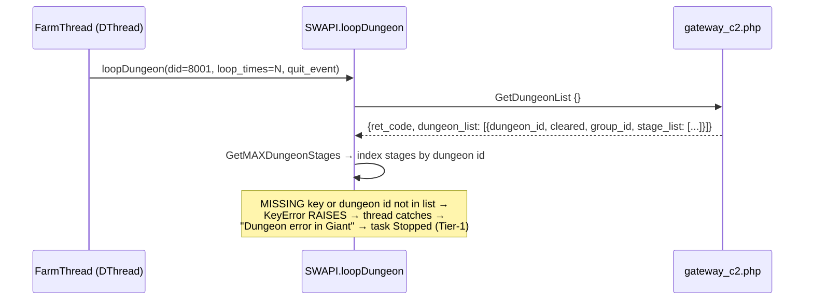

# AutoSW — Full Pipeline Flow (comprehensive reference)

The definitive end-to-end flow: what happens from app boot → profile load →
login → task creation → the battle loop → drop handling → stop. Everything
here is evidence-backed: live probes of the compiled modules
(`work/autosw/trace/`), the frontend bundle (`work/autosw/main.beautified.js`),
string dumps, and a real `HubUserLogin` capture. Companion docs: 01–06
(architecture, crypto, modules, SWAPI, automation engine, worker threads);
this doc is the *walkthrough* that ties them into one pipeline.

---

## 0. The pipeline at a glance

```
[BOOT]  main.exe → ui.pyd → WebView2 + Vue SPA
   │
[LOGIN] IndexControl.login → HubUserLogin  (encrypted envelope, gateway_c2.php)
   │        └─ response = ACCOUNT SNAPSHOT (wizard_info, unit_list, runes, …)
   │        └─ persisted as profiles/<wizard_id>.json
   │
[CONFIG] UI dropdowns ← MainControl.dungeon_list() → GetDungeonList
   │     rulesets ← get_rules/save_rules (rules.json next to exe)
   │
[TASK]   user clicks a task → MainControl.<task>(payload) → create_task
   │        └─ FarmThread started; task_id/params/status/conflict registered
   │
[LOOP]   thread.run → SWAPI.loop* (loopDungeon / loopAllTower / …)
   │        ├─ ① GetDungeonList + GetMAXDungeonStages   (MANDATORY at loop start)
   │        └─ ② per iteration:
   │              sync wizard → smart_refill (energy policy)
   │              → battle unit (Do*) → wait simulated clear time
   │              → result submit → drop eval → sell/keep
   │              → loop_times-- ; check quit_event
   │
[STOP]   stop_task → quit_event.set() → current battle finishes → thread exits
```

---

## 1. Boot & login pipeline

1. **Process boot.** `main.exe` (PyInstaller bootloader, Python 3.11) unpacks
   and runs `ui.main()`. The process joins a Windows Job Object
   (`assign_process_to_job_object`) so killing the UI kills all task threads.
2. **UI bridge.** `ui.pyd` opens a WebView2 window hosting the Vue SPA
   (`html/js/main.js`). The SPA calls `window.pywebview.api.<Class>.<method>`
   — that is the entire IPC surface.
3. **Login (`HubUserLogin`).** `IndexControl.login` drives the login thread:
   session key exchange (RSA-**4096** public key baked into `common.pyd`, see
   docs/02 §5), then `HubUserLogin` over the encrypted envelope. The clean-room
   port lives in `src/swauto/net/login.py` (8-field request builder, version
   fetch, response parser, `apply_session`, `LoginClient`, `manual_relogin`,
   `check_login_block`).

   *Live boundary (B6, 2026-09-07):* the `version_info_c2` fetch and the
   8-field `HubUserLogin` body + captured gateway headers are ported and
   **live-proven** (`GatewayTransport`, `LiveVersionFetcher`,
   `swauto live-login`; the real `version_data` is a list of per-topic rows).
   A live run of just the 8-field login was **refused `ret_code 1006`** — the
   RSA-4096 session-key exchange that precedes HubUserLogin is a live-only step
   no offline capture reconstructs (A1 §5), so the login leg stays live-gated
   at that exchange until a session-key source is supplied. Evidence:
   `work/autosw/trace/_B6_live_login_outcome.md`.
4. **Account snapshot.** The `HubUserLogin` response IS the account profile
   (verified against a real capture, `C:\GitHub\xstomper\profiles\7280513.json`):

   | Section | Used by |
   |---|---|
   | `wizard_info` (`wizard_energy`, `wizard_crystal`, `wizard_mana`, `arena_energy`) | resource mirror (energy policy) |
   | `unit_list` (229 units: `unit_id`, `class` stars, `unit_level`, `spd`, `runes`) | deck building |
   | `runes` / `artifacts` (`pri_eff`, `sec_eff`, `upgrade_curr`, `occupied_id`) | inventory cleaner, rune eval |
   | `deck_list`, `raid_best_clear_info_list`, `pvp_info`, quests, shop | task preconditions |
   | `this_server_id`, `wizard_id`, session keys | session routing |

   AutoSW persists it as `profiles/<wizard_id>.json` (`ProfileThread`).
   **Loading this file never needs the network** — it is a cache of the login
   response. Sensitive fields (`session_key`, `token`) live in it; never
   commit raw captures.
5. **Startup fetches (UI-facing).** When the user opens a task settings
   dialog, the SPA calls `MainControl.dungeon_list()` → backend `GetDungeonList`
   → `{value, text, hoh}` rows for the dropdown. Failure here surfaces to the
   UI as "Error update dungeon list" — the bot itself is still fine.

---

## 2. Task creation pipeline (UI → thread)

Exact payloads in docs/05 §4; flow semantics in docs/06 §3. Condensed:

```
SPA: MainControl.dungeon(dungeon_id, hoh, times, rune_keep, rune_opts)
     │ license gate: sub_time > 0 (else "No subscribe time left")
     ▼
MainControl.create_task(thread_cls, params...)
     │ ① conflict gate: task_conflict set ∩ running sets → "Task conflict" (reject)
     │ ② PVP gate: pvp_required && !pvp_enabled → "PVP mode required"
     │ ③ allocate task_id; register tasks/task_params(verbatim)/task_status/task_conflict
     ▼
FarmThread.__init__(task_id, params) → .start()
     ▼
FarmThread.run() = try { loop entry(params) } except { "<Domain> error in ..." }
                   finally { task_status="Stopped"; "<Domain> farming stopped" }
     ▼
SPA: add_task(label, task_id) → row {task, start, status:"Running"}
     polled every 3 s via MainControl.task_status(id)   (pure pull)
```

Defaults applied by the UI before sending: `farm_times` invalid/≤0 →
**99999**; Hall-of-Heroes stages capped at **10**.

---

## 3. The dungeon pipeline (deepest traced — Giant example)

This is the full per-task flow, with the exact wire requests/responses
recovered by live-probing the original `loopDungeon`/`DoDungeon`
(`work/autosw/trace/dungeon_loop2.py`, `timing_experiment*.py`).

### 3.1 Loop start — MANDATORY list fetch (Tier-1 fatal)



The profile does **not** need to contain a dungeon list — this fetch happens
here, fresh, every task start.

### 3.2 Per-iteration cycle

```mermaid
sequenceDiagram
    autonumber
    participant S as loopDungeon iteration
    participant G as gateway_c2.php
    participant R as score.pyd + rules.pyd

    S->>G: GetWizardInfo (resource mirror refresh)
    S->>S: smart_refill — energy < cost?
    Note over S: energy paths: buy with crystals (BuyShopItem)<br/>or social points; neither → "Cannot refresh energy!"<br/>→ loop stops (out of energy)
    S->>G: GetDungeonBestCommunityRanking {group_id}
    G-->>S: {my_ranking: {clear_time (ms), my_unit_deck_list}}
    Note over S: record = clear_time/1000; absent → 240 s fallback
    S->>G: BattleDungeonStart {dungeon_id, stage_id, unit_id_list, equip,<br/>helper_list, mentor_helper_list, npc_friend_helper_list,<br/>is_rooting:0, cash_used:0, retry:0, auto_repeat:0}
    G-->>S: {battle_key, dungeon_unit_list: [waves..., boss_wave]}
    Note over S: WAIT = max(best_record, 20) + uniform(0, 6) seconds<br/>("Waiting for {} seconds...")<br/>— NOT from unit stats, waves, or turn count
    S->>G: BattleDungeonResult_V2 (win=1, drops echoed)
    G-->>S: {drop_list: runes/artifacts/gems}
    S->>R: handle_rune / handle_artifact
    R-->>S: keep (log "Got a ...") | sell → SellRune / SellArtifacts
    Note over S: loop_times -= 1; check quit_event → next iteration
```

### 3.3 The timing formula (confirmed)

| Content | Wait before result submission |
|---|---|
| Cairos dungeons (Giant, Dragon, …) | `max(own best record, 20 s) + uniform(0, 6) s` — record fetched live via `GetDungeonBestCommunityRanking`; no record → 240 s default |
| ToA normal | floor 1 = 15.4 s, floor 2 = 12.8 s, floor L ≥ 3 = `6.4 × L` |
| ToA hard | `10.4 × L` (all floors) |
| ToA hell | base ≈ `1810 + 7×(L−1)` with uniform jitter ≈ ±300 s |

Profile best-record storage: **only Rift Raid** (`raid_best_clear_info_list`);
Cairos records come from the server each battle.

### 3.4 Drop handling detail

- The drop table arrives **in the start response** — the bot knows the loot
  before "fighting"; the wait is purely anti-detection.
- Runes: flatten `pri_eff`/`sec_eff` (EFF_TYPE ids → stat names) →
  `RuneScore = Σ(value × weight)` vs **smart level**, and the rulesets
  (`rules.json`, `RuleSet.check()` flat-map semantics) → keep or `SellRune`.
- Raid gems/grinds: `isShitStone`/`isTrashStats` + the `special` keep list.
- Errors inside one battle iteration are **logged and skipped** ("Error in
  farming N times"); the loop continues to `loop_times` exhaustion (Tier-2).

### 3.5 Energy refill policy — recovered EXACTLY (live probe)

`smart_refill(winfo, required)` reads exactly two winfo keys
(`wizard_energy`, `social_point_current`) and then `wizard_crystal`:

| Step | Condition | Action | Item id |
|---|---|---|---|
| 1 | `energy ≥ required` | return True (no request) | — |
| 2 | `social_point_current > 500` | "Buying energy by social points..." → `BuyShopItem` | `2201001` (Heart energy) |
| 3 | `wizard_crystal ≥ 300` | "Buying energy by crystals..." → `BuyShopItem` | `100004` (290-crystal energy) |
| 4 | neither | "Cannot refresh energy!" → False | — |

Thresholds verified by bisection: social 500→False / 501→True;
crystals 299→False / 300→True.

### 3.6 Rune scoring — `eval_rune` recovered EXACTLY (live probe)

`eval_rune(rune) = Σ substat_value × weight` — substats only (prefix, upgrade
level, and roll counts have **zero** effect). Weights per point, verified
byte-exact against the user's real runes (legend 6★ = 105.0):

| Stat | Weight/pt | Stat | Weight/pt |
|---|---|---|---|
| SPD | 10/3 ≈ 3.3333 | HP% / ATK% / DEF% | 2.5 |
| CRate | 10/3 ≈ 3.3333 | RES / ACC | 2.5 |
| CDmg | 20/7 ≈ 2.8571 | ATK flat / DEF flat | 0.35 |
| | | HP flat | 7/375 ≈ 0.01867 |

Helpers also recovered: `getValuableStats(rune, smart)` → `{type_id: count}`
of valuable substats; `smartUpgradeCheck(old, new, vstats, spd_only)`; and
`isTrashStats(sets, prop)` — the flat-substat predicate. **All three are now
recovered exactly and ported to `swauto/game/evaluate.py`** (verified against
the compiled oracle over the real MooN pool: 7512/7512, 7452/7452, 8300/8300).

Exact `getValuableStats` rule (7452/7452): only `class == 6` runes ever yield
valuable stats (classes 7+ are ancient-era ids the original treats as trash);
within that, every hard sub present (2 HP%, 4 ATK%, 6 DEF%, 8 SPD, 9 CR, 10 CD)
is valuable at value 1, except RES(11)/ACC(12)/flats(1/3/5) which are never
valuable, and a set-specific de-emphasis that drops one percentage stat on
Fatal (set 8 → drop DEF%) and Guard (set 2 → drop ATK%) runes. The `smart`
argument is read but never changes the result.

**Artifact evaluation — recovered EXACTLY** (`work/autosw/trace/arti_probe.py`,
implemented in `swauto/game/artifacts.py`): substat ids 200–411 with per-id
roll ranges (ARTI_SUB table, fully dumped); sub quality =
`value / midpoint(min_roll, max_roll)`.

`getArtifactValuableSub(arti, guess)` (STATIC, recovered by exhaustive sweep):
`guess=True` → `{sid: ratio}` for every **present** valuable sub;
`guess=False` (the form keep/sell and `valuable_subs` implement) →
`{sid: 1}` for the strict subset whose raw value is ≥ a per-sub floor. A sub
is valuable iff its id is in the valuable union (presence-only group OR
value-floored group) and NOT in the never set:

- **Never valuable** (regardless of value): `{203, 207, 209, 211, 212, 213,
  216, 217, 403}` — SPD-under-inability, CR-increasing effect, counterattack
  dmg, reflect dmg, crushing-hit dmg, dmg-received-under-inability,
  HP/ATB-when-revived, Skill-4 CD.
- **Presence-only valuable** (any value, even 0/negative): `{204, 205, 218,
  219, 220, 221, 226, 400, 401, 402, 404, 405, 406, 407, 408, 409, 410, 411}`.
- **Value-floored valuable** (value ≥ floor): `200/201/202 ≥ 12`, `206 ≥ 5`,
  `208/210/214/224/225 ≥ 3`, `215 ≥ 6`, `222 ≥ 5`, `223 ≥ 10`, `300–304 ≥ 4`,
  `305–309 ≥ 5`.

The earlier `ratio >= 1` heuristic was WRONG (it counted never-valid subs
whose ratio crossed 1.0 and dropped presence/floor groups below it). The rule
above is verified **777/777** real MooN artifacts + **5000/5000** adversarial
synthetic + exhaustive floor-boundary sweeps — all zero mismatches. E.g. rid
304066801 (SPD-deck HP artifact) → valuable = {401 Skill-2 CD, 208
Counterattack DMG}; rid 315845666 → all four subs valuable. Main stats:
100/101/102 = HP/ATK/DEF flat.

### 3.7 Battle-unit and loop signatures (exact, embedded annotations)

```
DoDungeon(self, did, stage=10, secret=False, auto=0, rune_options=None, arti_options=None)
DoTower(self, level, difficulty, condition_list=None)
DoScenario(self, units=[], region=9, stage=1, difficulty=3, wait=30, friend=None)
DoRift(self, did, auto=0, rune_options=None, craft_options=None)
DoDHole(self, did, diff=None, rune_options=None, arti_options=None, craft_options=None)
DoArena(self, oppid)
DoMaze(self, tile, unit, difficulty=3)

loopDungeon(self, did, loop_times=999999, quit_event=None, from_bot=False, rune_options=None, arti_options=None)
loop_D_HOLE(self, did, looptimes=100, quit_event=None, rune_options=None, arti_options=None, craft_options=None)
loopTower(self, level=1, difficulty=1, quit_event=None)
loopAllTOA(self, diff=1, quit_event=None)
loopTOAHell(self, quit_event=None)
loopRift(self, did, looptimes=999999, quit_event=None, rune_options=None, craft_options=None)
loopRaid(self, loop_times=999999, quit_event=None, from_bot=False, craft_options=None)
loopScenario(self, units, times=999999, quit_event=None)
loopArena(self, reverse=True, attack_npc=False, quit_event=None)
loopGuildwar(self, quit_event=None)          loopGuildRival(self, quit_event=None)
loopHOH(self, did, quit_event=None)          loopallunskill(self, times, quit_event=None)
bot(self, bot_options=None, quit_event=None, rune_options=None, arti_options=None)
inventory_clean(self, options=None, quit_event=None)
smart_refill(self, winfo=None, required=8)
farm_deter(self, times=10)
```

Loop-level first fetches observed: `loopScenario` → `GetFriendList` (friend
assist data: `assist_count`); `loopArena` → `GetWizardInfo` →
`GetArenaWizardList`; `loopRaid` → `GetRiftOfWorldsRaidServerInfo`
(`stage_id`); each has a config/precondition chain
(`ARENA_CONFIG`, `D_HOLE_CONFIG`, `tower_deck`, `fill_units`, …) — the
dungeon pipeline (§3) is the deepest traced end-to-end.

Exact start-request shapes recovered so far:
`BattleScenarioStart {region_id, difficulty, unit_id_list, stage_no,
helper_list, mentor_helper_list, npc_friend_helper_list, retry, auto_repeat}`;
`BattleDungeonStart` (§3.2). The remaining start commands
(`BattleTrialTowerStart_v3`, `BattleRiftDungeonStart`,
`BattleDimensionHoleDungeonStart`) follow the same
`battle_key` + unit-list + drop-list pattern. Note: there is **no**
`BattleArenaStart` or `BattleRaidStart` string in the oracle (see §3.8) —
arena/raid wire rows are reconstructions.

### 3.5 Loop counting & stop

- `farm_times` → `loop_times`; each iteration decrements; 0 → loop ends
  ("<Domain> farming stopped").
- `stop_task` sets `quit_event`; checked **between** iterations only — the
  in-flight battle always completes and its result is submitted (cooperative
  stop; server-side sanity makes this mandatory, not optional).

---

### 3.8 Content units beyond dungeon — recovery status (honest line)

Extensive probing (harness with per-command scripted responses, instance
attribute seeding incl. the real `monsters.data` bestiary — a 2,967-entry
pickle of monster master data, loaded by the original into `self.monsters` —
plus targeted disassembly of `loopRaid`) established:

**Recovered to a real captured start payload (A4 — see
`work/autosw/trace/_A4_content_recovery_outcome.md`):**

- **Cairos family — `BattleDungeonStart` is now a complete, recovered-exact
  reference.** Driving `loopDungeon` across the whole family (giant 8001 /
  dragon 9001 / necro 6001 / steel 9501 / magic 5001 / dark 1001 + abyss and
  7001) yields the real chain `GetDungeonList → GetDungeonBestCommunityRanking
  {group_id:1} → GetWizardInfo → BattleDungeonStart`, whose payload uses
  **`stage_id`** (NOT `stage`), **`unit_id_list: [{"unit_id": int}, ...]`**
  (objects, NOT bare ints), and **`equip: null`** (NOT `[]`). This proves the
  earlier port skeleton's three fields were wrong and are now fixed in
  `client.do_dungeon` (A4 §1). Result command `BattleDungeonResult_V2`.
- **Dimension-Hole — `BattleDimensionHoleDungeonStart` recovered-exact.** The
  dhole deck object exposes a `fill_data(start_payload, mode='rift',
  swcore=...)` that the loop calls to write the 16-unit `dungeon_units` list
  (leader at slot 0, `position` 1..15). Recovered payload: `dungeon_id /
  difficulty / practice_mode / retry / is_rooting / auto_repeat / dungeon_units
  / dungeon_level / dungeon_stage / helper_list / npc_friend_helper_list`.
  Ported as `client.do_dhole` + `loops.loop_dhole` (A4 §2). The post-start
  result parse (`BattleDimensionHoleDungeonResult_v2`) mutates a live-session
  response structure — documented live boundary.
- Command names on the wire (from the summon.pyd string table): 
  `BattleRiftOfWorldsRaidStart` / `BattleRiftOfWorldsRaidResult`,
  `BattleTrialTowerStart_v3` / `BattleTrialTowerResult_v3`,
  `BattleDimensionHoleDungeonStart` / `BattleDimensionHoleDungeonResult_v2`,
  `BattleGuildWarStart` / `BattleGuildWarResult`. **No `BattleArenaStart` or
  `BattleRaidStart` string exists** — any arena/raid "BattleArenaStart"-shaped
  wire row is a reconstruction, not a captured command.
- Exact signatures for every `Do*` and `loop*` (§3.7).
- **Scenario is a 2nd complete reference** (B2 re-probe): the full loop
  chain `GetFriendList {}` → `GetWizardInfo {}` → `BattleScenarioStart` is
  recovered offline, including the friend-assist semantics (a friend with a rep
  unit is drawn as `helper_list: [{"unit_id", "wizard_id"}]`). Implemented in
  `client.do_scenario` + `loops.loop_scenario`. The post-start enemy-mutation
  (result handling) stays live-gated (TypeError at summon.py:2877) — the request
  contract the port sends is fully pinned by the captured payloads.
- First fetches: raid → `GetRiftOfWorldsRaidServerInfo` (returns `stage_id`,
  `raid_id`); arena → `GetWizardInfo` → `GetArenaWizardList`; scenario →
  `GetFriendList` (friend assist data: `assist_count`, rep units).
- `loopRaid`'s first action reads `RAID_CONFIG['stage_id']` (confirmed by
  read-spy + KeyError traceback at summon.py line 3331).
- Failure semantics for all units: silent local guards (no exception), so a
  port should mirror "check config → bail quietly".

**Live boundary — battle starts not reachable offline after a real convergence
attempt, per unit:**

- **Rift (`loopRift`/`DoRift`)**: `DoRift` on a `__new__` SWCore returns None
  (Do* cores need `SWCore.__init__(SWCONFIG)` cdef state, whose constructor
  performs a live network call). `loopRift` reads `RIFT_CONFIG[did]['unit']`
  but bails on **"No units found!"** before touching any deck content — an
  account-state gate not reproducible offline. Rift element ids recovered
  (ICE 1001 / FIRE 2001 / WIND 3001 / LIGHT 4001 / DARK 5001; `RIFT_DECK=8`).
- **Tower (`loopTower`/`DoTower`)**: `tower_deck.fill_units(5, swapi)` is
  called then `GetWizardInfo` and a silent return — a live wizard/tower gate.
  The `BattleTrialTowerStart_v3` wire row in swauto (`do_tower`) was already
  correct (ToA implemented); its exact field list is not offline-recoverable.
- **HOH / secret / event instance (`loopHOH`, `battleInstance`)**: command
  surface + `SECRET_*` 10065-10076 + `SECRET_DECK=9` recovered; the instance
  start is live-event-availability gated.
- **Guild War (`loopGuildwar`)**: `BattleGuildWarStart` string recovered,
  `GUILD_DECK=6`; the start is live-guild/energy gated. Guild-siege/rival stay
  documented-only.

These live-boundary guards were each **earned** — an armed drive was attempted
and its specific guard recorded (A4 §3-§6) — never silently replaced by an
inferred skeleton.
- Disassembly note: the compiled guards use Cython hash-based string
  dispatch; mapping the constants to attribute names is feasible but a
  dedicated effort (see `work/autosw/trace/disasm4.py` for the tooling).

Consequence for the port: the **dungeon, scenario, and dimension-hole
pipelines are the complete references** (dungeon + dhole payloads recovered
exact); the remaining content units (rift / tower-beyond-existing / hoh /
guildwar) share the skeleton but their battle starts are live-boundary until a
live session trace supplies the start fields.

---

### 3.9 Crafts, upgrade cycle, and deck building — recovered (live probes)

**Craft items (gems/grinds/enchants)** — `craft_type`: 1 gems, 2 grindstones,
3/4 enchant gems, 5/6 ancient. Gem grade = last digit of `craft_type_id`.
Recovered policy (`isShitStone`, bisection-verified on the account's 591
craft items; implemented in `swauto/game/crafts.py`):

| Item | Policy |
|---|---|
| Ancient grindstones (type 5) | always kept |
| Grade-5 gems/grinds | always kept |
| Grade-4 gems/grinds | kept only while smart ≤ 4 |
| Grade ≤ 3, enchant gems, ancient gems | sold (smart-dependent for 6) |

The craft_options dict carries the same rune-keep shape (`smart`, `special`,
…); the `special` set-keep list showed no effect on the sampled items.

**Upgrade cycle (inventory cleaner)** — the cleaner powers up in one-level
cycles: each cycle sends `UpgradeRune_v2 {rune_id, cash_used:0,
loginextend_refcount:0, upgrade_target:15}` and re-judges; the cycle repeats
until the rune is sold, kept, or at max. Implemented in `swauto` as
`BattleClient.power_up_all_runes(runes, options)` / `inventory_clean(runes,
options)` (Loops entry: `loop_inventory_clean`).

The judgment helpers are recovered exactly (ported to `evaluate.py`,
verified 8300/8300 against the compiled oracle):

- `smartUpgradeCheck(old, new, vstats, speed_upgrade_only)` returns **True**
  (a valuable stat grew past its floor — stop powering, keep), **False** (a
  valuable stat grew but stayed below the per-stat value floor, or under
  `speed_upgrade_only` a valuable non-SPD stat grew while SPD did not — a
  "failed" roll, not a keeper), or **None** (nothing valuable grew — keep
  powering).
- The value floor is per stat: SPD/CR need grown value ≥ 10, CD ≥ 11, and
  HP%/ATK%/DEF% ≥ 13 (raw substat wire value).
- `getValuableStats(rune, smart)` returns the valuable substat map
  `{type_id: 1}` per §3.6's exact rule.
- `isTrashStats(sets, prop)` is True iff `prop` is a flat (1/3/5) — the
  "trash roll" test.

Internal rune storage is a dict keyed by `rune_id` (`self.runes.values()`).

**Lock-aware selling (Phase B1 corrective — the oracle is lock-blind).**
The original app never reads the server lock fields: a raw byte scan of
`summon.pyd`/`common.pyd`/`control.pyd` shows `rune_lock_list` and `lock_type`
occur **0 times**, and the artifact `locked` field is never consulted — so the
compiled cleaner would sell a player-locked rune. The clean-room port marks
**both** rune and artifact lock sources and skips them in every sell/upgrade
path: `inventory_clean`, `power_up_all_runes`, `power_up_all_artifacts`,
`handle_rune`, `handle_artifact`. A locked item is treated as kept (never
sold, never upgraded, never counted as sold).

- Rune locks: the HubUserLogin `rune_lock_list` entries `{lock_type, rune_id}`;
  a `lock_type` of 1 is active. Surfaced as
  `AccountSnapshot.locked_rune_ids()` (→ `BattleClient.locked_rune_ids`).
- Artifact locks: each artifact's `locked` field (`1` = pinned). Surfaced as
  `AccountSnapshot.locked_artifact_ids()`.

**Batched rune sell.** The oracle's `SWCore.sellRune(rids)` emits ONE
`SellRune {rune_id_list: [...]}` for the whole batch; the port batches the
construction-trash pass and any single sell through
`BattleClient._sell_runes(ids)` (which also re-filters locked ids), matching
the probed wire shape instead of one call per rune.

**Count/capacity guard.** `SWCore.check_rune_count`/`check_artifact_count`
read instance state and are fully reproducible offline (Phase A3 re-probe,
2026-09-07): each fires **strictly over** the cap (`count > max`), and the
defaults are `rune_max = artifact_max = 1500` — NOT the cap of 1,000 the old
docs/report claimed. `BattleClient` exposes these as
`over_rune_cap()`/`over_artifact_cap()` (constants `C.RUNE_CAP = C.ARTIFACT_CAP
= 1500`). Inventory counts are fed from the account snapshot or a refresh.

**Artifact upgrade cycle (inventory cleaner)** — the artifact analog of the
rune cycle above, implemented in `swauto` as
`BattleClient.power_up_all_artifacts(artifacts, options)`, reached from
`inventory_clean(runes, artifacts=None, options)` when artifacts are supplied
(Loops entry: `loop_inventory_clean(..., artifacts=...)`).

Key model difference vs runes: artifact properties are **revealed only at
+3/+6/+9/+12 milestones**, not rolled every level. So the cycle powers each
sub-max artifact to the next +3 milestone via `UpgradeArtifact_v2` (payload
`artifact_id` + `upgrade_target`, best-effort shape), re-judges the fresh
state with the recovered-exact `valuable_subs` (§3.6), and:

- a sub-max artifact is **never trash by its current substats alone** — one
  whose subs are all never-valid today can still reveal a valuable sub at the
  next milestone, so it is always a power candidate;
- a valuable reveal → keep and stop; still none at the upgrade cap (15) →
  sell via `SellArtifacts` (at the cap nothing can change, so the empty
  `valuable_subs` is final);
- an artifact already at the cap is kept or sold outright by `valuable_subs`
  without an upgrade.

**Structure-only, live-session-gated:** the original's
`smartArtifactUpgradeCheck` could not be recovered offline (Phase A probe: it
returns `False` for every real/synthetic dict — it reads live login/server
state). The decision source above is therefore the recovered-exact
`valuable_subs`, NOT `smartArtifactUpgradeCheck`'s own thresholds, and the
+3 cadence + `UpgradeArtifact_v2` payload are best-effort. This is the honest
boundary: keep/sell *value* is exact; the upgrade *orchestration* is a
structure-only port.

**Deck building — `best_equip` REPRODUCED OFFLINE** (`equip_probe.py`): with
the account's units, runes (dict by id) and artifacts loaded, the original
`best_equip(unit_ids)` runs with no network and returns the documented
contract:

```json
[{"unit_id": ..., "rune_id_list": [6 rune ids, slots 1..6],
  "artifact_id_list": [2 artifact ids]}, ...]
```

`swauto/game/equip.py` implements a clean-room greedy optimizer satisfying
the same contract (per-slot best score, rune exclusivity across the squad,
artifacts by archetype+value). This closes the deck-building gap: the full
battle pipeline (deck → start → wait → result → drops) now runs on real
account data end-to-end.

## 4. Other task pipelines (same skeleton, different units)

| Task | Loop entry | Battle unit | Timing | Special rules |
|---|---|---|---|---|
| Dungeon (Cairos) | `loopDungeon` | `DoDungeon` | record + jitter (§3.3) | deck sizes: Giant 7, Dragon 8, else 3 |
| Dimension Hole (2A) | `loop_D_HOLE` | `DoDHole` | like dungeon | deck 16; gem keep list `special` |
| ToA / TOAH / TOAHELL | `loopAllTower` / `loopTOAHhell` | `DoTower` | fixed tables (§3.3) | no run count — climbs 1→100 then stops |
| Scenario (fodder) | `loopScenario` | `DoScenario` | like dungeon | `farm_deter` picks stages; EXP building logic |
| Rift beasts | `loopRift` | `DoRift` | like dungeon | elemental rift ids |
| Solo raid | `loopRaid` | `DoRaid` | like dungeon | best-record source = `raid_best_clear_info_list` in profile |
| Arena | `loopArena` | `DoArena` | tailing wait 30 min when out of wings | targets from `GetArenaWizardList` (low power) |
| Guild War | `loopGuildwar` | guild units | energy-gated ("No guildwar energy!") | PVP-gated |
| Daily quests | `doAllDailyQuests` | — | one pass | no conflict set; can run beside PVE |
| Inventory clean | `inventory_clean` | — | batch | evaluate all unequipped → bulk sell failures |

All share: wizard sync → refill policy → battle unit → wait → result → drop
eval → count/stop check. Only timing and preconditions differ.

---

## 5. Cross-cutting layers (every arrow above)

1. **Crypto envelope** (docs/02): every request/response is
   `base64(AES-128-CBC(PKCS7(zlib?)))`, zero IV, static v1/v2 keys or the
   RSA-exchanged session key. Implemented + tested in `autoswkit.crypto`.
2. **Error model** (docs/06 §6.1): Tier-1 fatal at loop start (mandatory
   list fetch), Tier-2 log-and-skip per iteration. App never crashes from
   task failures.
3. **Conflict & PVP gates** (docs/06 §3): reject-at-start, no queue.
4. **Logging**: everything goes to `logs/General.log`
   (`%(asctime)s [%(levelname)s] %(message)s`), rotated by 7-Zip archiving;
   the UI battle log is the same feed.
5. **Subscription gate**: `sub_time` checked in the UI before any task
   starts ("No subscribe time left").

---

## 6. autoswkit mapping — implemented vs pending

| Pipeline stage | Original | autoswkit | Status |
|---|---|---|---|
| Envelope crypto | `cipher.pyd` | `crypto.py` | ✅ tested |
| Account snapshot → resources/units | login + `ProfileThread` | `profile.py` | ✅ tolerant loader |
| Profile store | `profiles/*.json` | `profile.py` | ✅ tolerant loader |
| Scheduler (create/stop/conflicts) | `control.pyd` `MainControl` | `engine.py` | ✅ incl. cooperative stop |
| Dungeon loop w/ record timing | `summon.SWAPI.loopDungeon` | `client.py` + `loops.py` | ✅ formula + record fetch |
| ToA timing | `getTowerTime` | `timing.py` | ✅ exact tables |
| Rules/score | `rules.pyd`/`score.pyd` | `rules.py`/`score.py` | ✅ exact eval_rune weights recovered; rule semantics verified vs live module |
| Rune keep/sell predicates | `isTrashStats`/`getValuableStats`/`smartUpgradeCheck` | `evaluate.py` | ✅ exact (19,809/19,809 vs compiled) |
| Inventory cleaner | `inventory_clean`/`power_up_all_runes` | `client.py` + `loops.loop_inventory_clean` | ✅ recovered `UpgradeRune_v2` upgrade-then-judge cycle |
| Artifact keep/sell source | `getArtifactValuableSub` | `artifacts.py` (`valuable_subs`) | ✅ exact membership rule (777/777 + 5000/5000 vs compiled) |
| Artifact upgrade cycle | `smartArtifactUpgradeCheck` | `client.power_up_all_artifacts` | 🟡 structure-only +3-milestone cycle (predicate live-session-gated, NOT exact) |
| Craft keep/sell | `isShitStone`/`handleRuneCraft` | `crafts.py` | ✅ recovered grade policy |
| Energy policy | `smart_refill` | `client.smart_refill` | ✅ exact policy: social>500 → 2201001, crystals≥300 → 100004 |
| Deck building | `best_equip`/`_best_six_runes` | `equip.py` | ✅ documented `best_equip` contract, verified vs real account |
| Login flow | `HubUserLogin` + RSA exchange | `net/login.py` (`LoginClient`, 8-field request, parser, `apply_session`) | 🟡 request/parser ported (offline replay) + live `version_info_c2` fetch proven (B6); RSA/skey exchange live-gated (live login refused 1006) |
| Manual re-login / block check | `manual_relogin` / `checkLoginBlock` | `net/login.py` | ✅ shell: version fetch → re-login; block read |
| Remaining SWAPI wrappers | 180 methods | ~12 battle/session commands | ⏳ per docs/04 |
| Shop refresh, quests, mail | `checkAndBuyShop`, `doAllDailyQuests`, … | `game/shop.py` (`get_shop_list`/`buy_shop_item`/`check_and_buy_shop` + guild variants) | 🟡 shop landed (B5); quests/mail ⏳ |
| Dungeon | `DoDungeon` | `client.do_dungeon` + `loops.loop_dungeon` | ✅ complete reference |
| Scenario | `DoScenario`/`loopScenario` | `client.do_scenario` + `loops.loop_scenario` | ✅ 2nd complete reference (friend fetch + captured payload) |
| ToA / rift / raid / dhole / arena units | `DoTower`/`DoRift`/`DoRaid`/`DoDHole`/`DoArena` | `client.do_tower` only | ⏳ payload field lists live-gated; stubbed |
| MITM "Power proxy" | `proxy.pyd` + WinDivert | — | 🚫 deliberately excluded |

Regression coverage: 100 tests, including end-to-end dungeon AND scenario
loops against a scripted fake server, lock-aware selling (B1), the captured
scenario payload contract (B2), the login flow — 8-field `HubUserLogin` request
shape, response-parser/session wiring, `manual_relogin`, `check_login_block`
(B3, offline replay) — the timing-formula bounds, the 20 s floor, the 240 s
no-record fallback, conflict/stop semantics, loop-continues-on-error, the exact
recovered rune-evaluation predicates, and the recovered artifact membership
rule (per-sub floors + presence + never sets, pinned 777/777 real + 5000/5000
synthetic) plus the artifact upgrade-cycle wire shape.

---

## 7. Evidence index

| Claim | Evidence |
|---|---|
| Wire request/response shapes (§3) | `work/autosw/trace/dungeon_loop2.py` (send-patch + KeySpy) |
| Timing formula + jitter bounds | `work/autosw/trace/timing_experiment*.py` (sampled runs) |
| Energy refill thresholds | `work/autosw/trace/refill_probe*.py` (bisection) |
| eval_rune weights | `work/autosw/trace/eval_weights*.py` (synthetic runes) |
| Battle-unit signatures | `work/autosw/trace/sig_all.py` (embedded annotations) |
| Two-tier failure semantics | `work/autosw/trace/loop_fail*.py`, `fail_probe.py` |
| Task payloads & UI defaults | `work/autosw/main.beautified.js` (docs/05 §4) |
| Account snapshot format | real `HubUserLogin` capture (user-provided; sanitized fixture in `tests/fixtures/`) |
| Login wire (8-field body, endpoint, field roles) | `work/autosw/trace/_A1_login_outcome.md` (`_login_*` probes) |
| Gateway header contract, version 4-field body + live topic-row shape, live-login 1006 boundary | `work/autosw/trace/_B6_live_login_outcome.md` (`_version_request_capture.py`, live run) |
| Shop list/buy wire + `checkShopItem` predicate | `work/autosw/trace/_B5_shop_recovery_outcome.md` (`_shop_*` probes) |
| `common.pub_key` RSA-4096 / `refresh_ts` field | `work/autosw/trace/_B4_doc_recon_outcome.md` (direct oracle measurement) |
| Class chain `object→SWCore→SWAPI` | `work/autosw/trace/classes.py` (`__mro__`) |
| Constants (IDs, decks, stat maps) | `work/autosw/trace/constants_dump.json` → `autoswkit/constants.py` |
